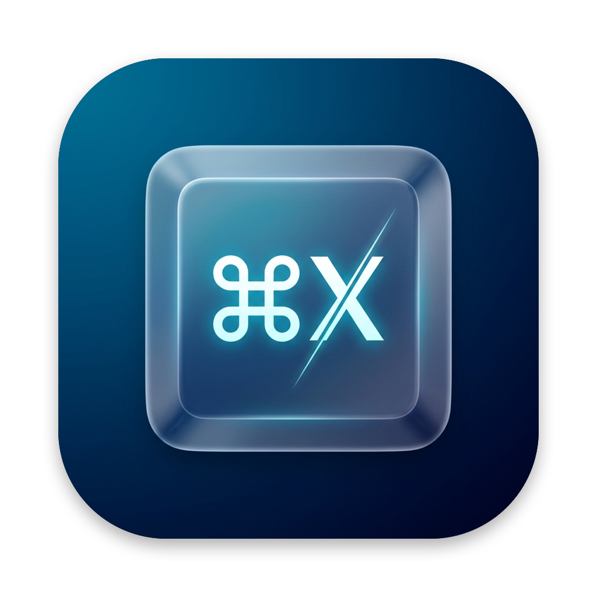

<p align="center">
  
</p>

<h1 align="center">MoveX</h1>

<p align="center"><strong>在 Mac 访达里，按 ⌘X 剪切文件，按 ⌘V 移到新位置。</strong></p>

<p align="center">
  <a href="https://github.com/euanlin0393-oss/MoveX/raw/refs/heads/downloads/MoveX-1.0.0-Universal.dmg">下载 MoveX · Download</a>
  · <a href="#english">English</a>
  · <a href="LICENSE">MIT License</a>
</p>

<p align="center">macOS 13 或更新版本 · Apple 芯片与 Intel Mac</p>

## 怎么用

| 操作 | 效果 |
| --- | --- |
| 在访达或桌面选中文件、文件夹，按 <kbd>⌘</kbd><kbd>X</kbd> | 标记为待移动。此时文件仍在原位置。 |
| 打开目标文件夹，按 <kbd>⌘</kbd><kbd>V</kbd> | 调用访达自带的「将项目移到此处」（<kbd>⌥</kbd><kbd>⌘</kbd><kbd>V</kbd>）。 |
| 在访达按 <kbd>Esc</kbd>，或在菜单栏选择「取消待剪切状态」 | 取消这次待移动操作。可在菜单栏关闭 Esc 取消。 |

复制其他内容或剪贴板发生变化时，MoveX 会取消待移动状态。在访达的重命名、搜索等文本输入框中，⌘X 和 ⌘V 仍用于编辑文字。菜单栏可随时暂停 MoveX、切换图标、关闭提示音或设置登录时启动。

## 安装

1. 下载 [MoveX-1.0.0-Universal.dmg](https://github.com/euanlin0393-oss/MoveX/raw/refs/heads/downloads/MoveX-1.0.0-Universal.dmg)，把 `MoveX.app` 拖到「应用程序」。
2. 首次打开时，macOS 可能提示无法验证应用。这个版本使用临时签名（ad-hoc），未通过 Apple 公证。如果你确认下载来源并信任该文件，可在尝试打开后，前往「系统设置 → 隐私与安全性」，点击「仍要打开」。[Apple 安装说明](https://support.apple.com/zh-cn/102445)
3. 按应用提示，前往「系统设置 → 隐私与安全性 → 辅助功能」，开启 MoveX 的权限。MoveX 用这个权限在访达里识别快捷键，并区分文件选择与文本输入。

## 从源码构建

需要 macOS 和带有 Swift 编译器的 Xcode Command Line Tools。进入仓库目录后运行：

```bash
./scripts/build.sh       # dist/MoveX.app
./scripts/build-dmg.sh   # dist/MoveX-1.0.0-Universal.dmg
```

## English

MoveX is a native macOS menu bar app for moving files and folders in Finder and on the desktop with **⌘X → ⌘V**. It requires macOS 13 or later and runs on both Apple silicon and Intel Macs.

- Select items and press **⌘X** to mark them for moving. Open the destination folder and press **⌘V** to run Finder’s built-in **Move Item Here** command.
- Press **Esc** in Finder or cancel from the menu bar to clear the pending move. Copying something else or changing the clipboard also cancels it. Finder text fields keep their usual shortcuts.
- Pause MoveX, toggle sound, choose a menu bar icon, or enable launch at login from the menu bar.

**Install.** Download [MoveX-1.0.0-Universal.dmg](https://github.com/euanlin0393-oss/MoveX/raw/refs/heads/downloads/MoveX-1.0.0-Universal.dmg) and drag MoveX into Applications. This build is ad-hoc signed and has no Apple notarization. If macOS blocks the first launch and you trust the download, try opening it first, then use **System Settings → Privacy & Security → Open Anyway**. Enable MoveX under **Privacy & Security → Accessibility** to let it handle shortcuts and detect Finder text fields. [Apple support](https://support.apple.com/en-us/102445)

**Build.** Install the Xcode Command Line Tools with Swift, then run `./scripts/build.sh` for the app or `./scripts/build-dmg.sh` for the disk image.

## 致谢与许可证 · Credits and license

MoveX 以 Swift 编写，灵感来自 Sindre Sorhus 的 [Command X](https://sindresorhus.com/command-x)。项目采用 [MIT 许可证](LICENSE)。
